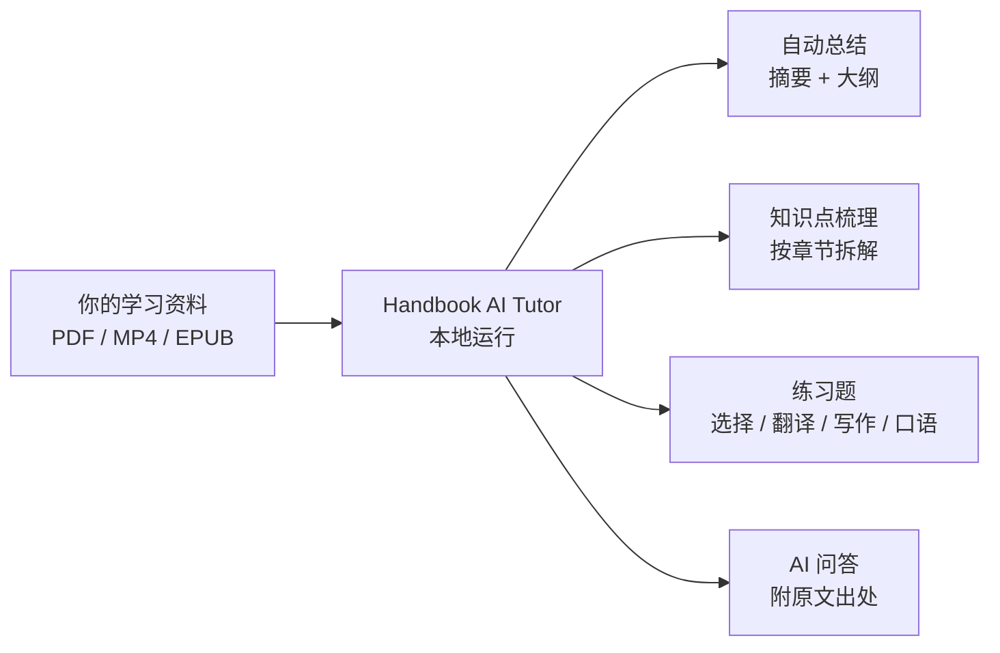
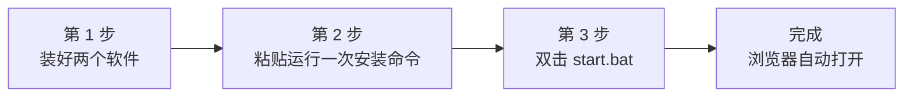
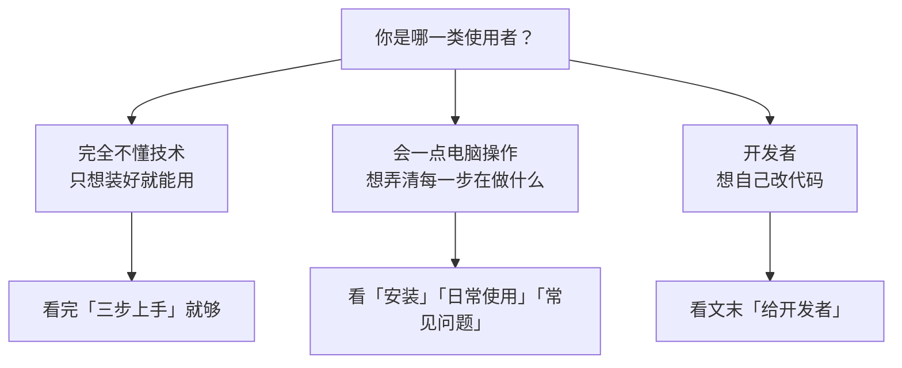
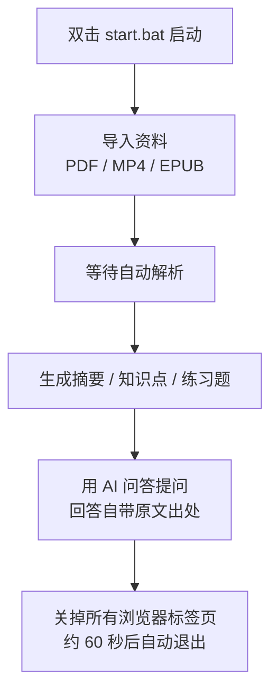
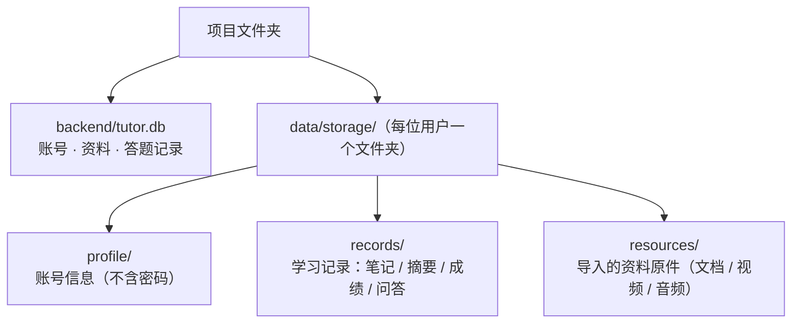

# Handbook AI Tutor（AI 智能学习助手）

把一份 **PDF、MP4 视频或 EPUB 电子书**交给它，它会自动帮你学习：

- **自动总结** —— 提炼全文摘要与大纲
- **知识点梳理** —— 按章节拆出关键知识点
- **出练习题** —— 生成选择题 + 翻译 / 写作 / 口语题，并给出解析
- **AI 问答** —— 像老师一样回答问题，每条回答都附原文出处（页码 / 时间戳）

全程在你自己的电脑上运行，资料不上传到任何服务器。



---

## 三步上手（不想看细节，只看这一节）



1. 装好 **Python** 和 **Node.js**（见下方「二、安装」，只装一次）。
2. 复制安装命令，粘贴运行一次（只做一次）。
3. 以后每次使用，**双击 `start.bat`** 就会打开 http://localhost:3000。

---

## 我该看哪一部分？



---

## 一、它能做什么

| 功能 | 一句话说明 | 你会得到 |
| --- | --- | --- |
| 自动总结 | 通读整份资料后提炼重点 | 全文摘要 + 章节大纲 |
| 知识点梳理 | 按章节把考点拆出来 | 一份知识点清单 |
| 出练习题 | 根据内容自动出题 | 选择题 + 翻译 / 写作 / 口语题，附解析 |
| AI 问答 | 就资料内容提问 | 像老师一样回答，并给出原文出处 |

---

## 二、安装（只做一次）

### 第 1 步：装两个软件

| 软件 | 版本要求 | 下载地址 | 安装提醒 |
| --- | --- | --- | --- |
| Python | 3.11 或更高 | https://www.python.org/downloads/ | 安装时**务必勾选 “Add Python to PATH”** |
| Node.js | 18 或更高 | https://nodejs.org/ | 选 **LTS 版**即可 |

> 如果命令行里能运行 `python --version`、`node --version`，说明已经装好，可跳过这一步。

### 第 2 步：粘贴运行一次安装命令

1. 把项目文件夹放到想长期存放的位置，例如 `D:\handbook-ai-tutor`。
2. 打开这个文件夹，在文件夹顶部**地址栏**里输入 `powershell` 再回车，弹出命令行窗口。
3. 把下面几行**依次**粘贴进去，每粘贴一行按一次回车：

```powershell
python -m venv .venv
.venv\Scripts\python.exe -m pip install -e "./backend[dev]" -i https://pypi.tuna.tsinghua.edu.cn/simple
cd frontend
npm install
npm run build
cd ..
```

看到命令全部跑完、没有红色报错，就说明安装成功了。以后不用再重复这一步。

### 第 3 步：打开网站

- **启动**：双击项目根目录下的 **`start.bat`**。它会先清理上次残留的进程，再启动前后端；转好的产物无需重建，通常几十秒内自动打开 **http://localhost:3000**。
  - 启动完可以**直接关掉那个黑色窗口**，应用会继续在后台运行。
  - 不想让它自动开浏览器，可以用 `start.bat /nobrowser`。
- **关闭**：**关掉所有浏览器标签页**即可 —— 约 60 秒后自动退出。
- 首次进入页面时，点右上角「注册」创建一个账号即可（账号、资料都只保存在本机，单人使用）。

---

## 三、日常使用



---

## 四、数据放在哪里

所有数据都保存在本机，不会上传。



---

## 五、（可选）接入真实 AI

默认使用「离线模拟」模型，不需要任何密钥就能跑通完整流程。想接入真实 AI（效果更好）：

1. 用**记事本**打开项目根目录的 `.env` 文件。
2. 找到 `DEEPSEEK_API_KEY=`，在等号后面填上你的 Key，保存。
3. 保存后重新双击 `start.bat` 重启即可。

> 密钥只保存在你本地的 `.env` 文件里，不会上传到任何地方。
> `.env` 必须用 **UTF-8** 保存。建议用 VS Code / Cursor 打开后，确认右下角编码是 UTF-8 再保存；不要用系统记事本另存为 ANSI / GBK，否则中文注释会变成乱码。

---

## 六、常见问题

| 现象 | 解决办法 |
| --- | --- |
| 双击 `start.bat` 一闪而过 | 看 `tmp\launcher.log` 最后几行；多数是「第 2 步安装」没跑完，或 Node 不在 PATH |
| 页面提示「无法连接后端服务」 | 再双击一次 `start.bat`（它会先清掉上次残留的进程再启动） |
| 浏览器打开了但不是我的内容 | 换电脑 / 换目录后，需要重新执行「第 2 步安装」 |
| `.env` 里中文变成「妯″瀷…」一类乱码 | 用 Cursor / VS Code 以 UTF-8 打开并保存；不要用记事本另存为 ANSI。改完后重新双击 `start.bat` |
| AI 问答回答出现乱码 | 重启后端后再问一次；已入库的旧对话可能仍是乱码，开新问题即可 |
| MP4 练习题只考老师口头禅 / 课程安排 | 先确认资料已重新导入（本次会同时读语音和 PPT / 板书画面），再点「生成练习题」 |

---

## 七、使用技巧

### 练习题：多次生成与删除

- 每点一次「重新生成」，都会**另存一套新题**，不会覆盖旧题组；旧题与作答记录都还在。
- 练习题页右侧会列出这份资料的全部题组，**每一套都能单独删除**。删除时可选：

| 方式 | 操作 | 结果 |
| --- | --- | --- |
| 保留成绩删题 | **不勾选**「同时删除该题组的作答记录」 | 题目与解析被移除；历史成绩仍留在「提交记录存档」里，还能点开看 |
| 彻底删除 | **勾选**「同时删除该题组的作答记录」 | 题目、作答记录一并**彻底删除，不可恢复** |

- 目前是**逐套删除**（一次删一套），没有「一键清空全部题组」的功能；要删多套重复操作即可。

### 其他小技巧

- **解析进度**：资料还在解析时，书架和原文页会显示实时进度。
- **文本来源**：摘要旁边会标明 OCR / 语音转写是真实识别还是离线模拟，避免把模拟逐字稿当成课堂原文。
- **引用跳转**：点击 AI 回答里的出处，左侧原文预览会跳到对应页或时间戳；练习题解析里的「跳到原文」同样回到这份资料。
- **旧视频要重新导入**：解析流程升级后，已导入过的 MP4 需重新导入（或重新上传）后再生成新题，才会带上课件画面内容。
- **用量**：设置页和资料页可以看到每个任务、每份资料用了多少 token（不换算金额）。

---

## 八、给开发者（可选阅读）

- 项目架构、技术选型与开发规范：见 [docs/architecture.md](docs/architecture.md)。
- 已知未完成 / 暂缓项：见 [docs/deferred.md](docs/deferred.md)。